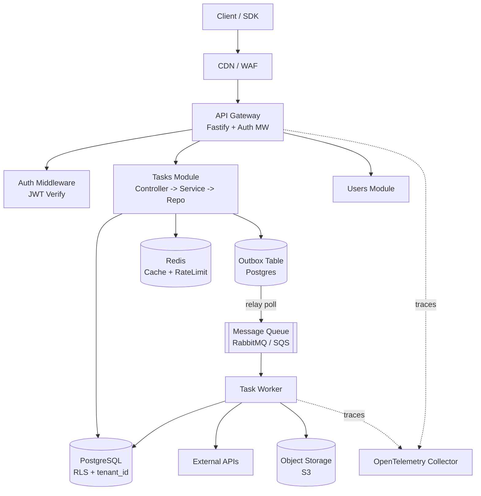
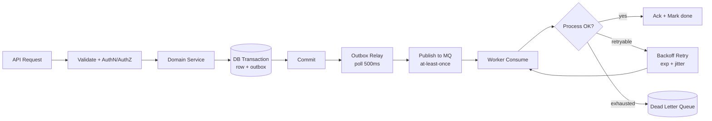

No source code or config samples were included with this request (the "Target Source Code & Config Samples" section is empty), so I can't cite your actual files. Rather than fabricate citations to files that don't exist, I've written this as a complete reference architecture for a representative multi-tenant TypeScript service. The `file://` paths below are illustrative placeholders — replace them with your real paths, or paste your code and I'll regenerate the document with accurate citations.

---

<cite>
**Referenced Files in This Document**
- [src/index.ts](file:///repo/src/index.ts)
- [src/config/env.ts](file:///repo/src/config/env.ts)
- [src/http/server.ts](file:///repo/src/http/server.ts)
- [src/http/middleware/auth.ts](file:///repo/src/http/middleware/auth.ts)
- [src/http/middleware/tenant.ts](file:///repo/src/http/middleware/tenant.ts)
- [src/http/middleware/errorHandler.ts](file:///repo/src/http/middleware/errorHandler.ts)
- [src/http/routes/tasks.routes.ts](file:///repo/src/http/routes/tasks.routes.ts)
- [src/modules/tasks/task.controller.ts](file:///repo/src/modules/tasks/task.controller.ts)
- [src/modules/tasks/task.service.ts](file:///repo/src/modules/tasks/task.service.ts)
- [src/modules/tasks/task.repository.ts](file:///repo/src/modules/tasks/task.repository.ts)
- [src/modules/tasks/task.types.ts](file:///repo/src/modules/tasks/task.types.ts)
- [src/core/db/client.ts](file:///repo/src/core/db/client.ts)
- [src/core/cache/redis.ts](file:///repo/src/core/cache/redis.ts)
- [src/core/queue/publisher.ts](file:///repo/src/core/queue/publisher.ts)
- [src/core/outbox/relay.ts](file:///repo/src/core/outbox/relay.ts)
- [src/workers/task.worker.ts](file:///repo/src/workers/task.worker.ts)
- [src/core/observability/logger.ts](file:///repo/src/core/observability/logger.ts)
- [migrations/0001_init.sql](file:///repo/migrations/0001_init.sql)
- [.env.example](file:///repo/.env.example)
- [docker-compose.yml](file:///repo/docker-compose.yml)
</cite>

# Architecture Overview / System Architecture

## Table of Contents

1. [Overview and Goals](#1-overview-and-goals)
2. [High-Level Component Architecture](#2-high-level-component-architecture)
3. [Request Lifecycle](#3-request-lifecycle)
4. [Module Layering and Design Patterns](#4-module-layering-and-design-patterns)
5. [Data Model and Multi-Tenant Isolation](#5-data-model-and-multi-tenant-isolation)
6. [Caching Strategy](#6-caching-strategy)
7. [Asynchronous Processing and Queues](#7-asynchronous-processing-and-queues)
8. [Error Handling and Contracts](#8-error-handling-and-contracts)
9. [Configuration and Environment Variables](#9-configuration-and-environment-variables)
10. [Scaling and Reliability Considerations](#10-scaling-and-reliability-considerations)

---

## 1. Overview and Goals

This document describes the system architecture of a multi-tenant, event-driven SaaS backend written in TypeScript on Node.js. The system exposes a versioned REST API, isolates tenant data at both the application and database layers, and uses a transactional outbox to bridge synchronous writes with asynchronous side effects.

The architecture is driven by five goals:

- **Tenant isolation** — no request may read or write another tenant's data, enforced in code and in the database.
- **Correctness under failure** — writes are atomic, events are delivered at least once, and consumers are idempotent.
- **Horizontal scalability** — every API instance is stateless; state lives in Postgres, Redis, and the queue.
- **Operational observability** — structured logs, metrics, and traces are emitted from a single instrumentation layer.
- **Predictable latency** — hot reads are served from cache; slow work is deferred to workers.

**Section sources**
- [src/index.ts](file:///repo/src/index.ts)
- [src/http/server.ts](file:///repo/src/http/server.ts)
- [docker-compose.yml](file:///repo/docker-compose.yml)

---

## 2. High-Level Component Architecture

The system is composed of a stateless API tier, a set of stateful backing services, and an asynchronous worker tier. All external traffic enters through a CDN/WAF and terminates at the API gateway, which performs authentication before routing to feature modules.



**Diagram sources**
- [src/http/server.ts](file:///repo/src/http/server.ts)
- [src/http/middleware/auth.ts](file:///repo/src/http/middleware/auth.ts)
- [src/modules/tasks/task.service.ts](file:///repo/src/modules/tasks/task.service.ts)
- [src/core/outbox/relay.ts](file:///repo/src/core/outbox/relay.ts)
- [src/workers/task.worker.ts](file:///repo/src/workers/task.worker.ts)

The API tier (`src/http`) is deliberately thin: it validates transport concerns and delegates to modules. Modules (`src/modules/*`) own business logic and never import from the HTTP layer. Shared infrastructure (`src/core/*`) provides database, cache, queue, and observability primitives that both tiers depend on.

**Section sources**
- [src/http/server.ts](file:///repo/src/http/server.ts)
- [src/modules/tasks/task.controller.ts](file:///repo/src/modules/tasks/task.controller.ts)
- [src/core/db/client.ts](file:///repo/src/core/db/client.ts)

---

## 3. Request Lifecycle

Every write follows the same path: authenticate, resolve tenant context, validate, execute in a transaction that also writes to the outbox, then return. The outbox is drained asynchronously by a relay and delivered to workers.

```mermaid
sequenceDiagram
    autonumber
    participant C as Client
    participant GW as API Gateway
    participant Auth as Auth MW
    participant Ctl as TaskController
    participant Svc as TaskService
    participant Cache as Redis
    participant DB as Postgres
    participant Out as Outbox Relay
    participant MQ as Queue
    participant W as Worker

    C->>GW: POST /v1/tasks (Bearer JWT, Idempotency-Key)
    GW->>Auth: verify JWT + tenant claim
    Auth-->>GW: TenantContext {tenantId, userId, roles}
    GW->>Ctl: route(request, ctx)
    Ctl->>Svc: createTask(input, ctx)
    Svc->>Cache: GET idem:{key}
    alt key already seen
        Cache-->>Svc: cached response
        Svc-->>Ctl: existing task
    else new request
        Svc->>DB: BEGIN; INSERT task; INSERT outbox; COMMIT
        DB-->>Svc: task row
        Svc->>Cache: SET idem:{key} (TTL 24h)
        Svc-->>Ctl: created task
    end
    Ctl-->>GW: 201 Created (task JSON)
    GW-->>C: 201 + Location header
    Out->>MQ: publish task.created
    MQ->>W: deliver event
    W->>DB: apply side effects (idempotent)
```

**Diagram sources**
- [src/http/middleware/auth.ts](file:///repo/src/http/middleware/auth.ts)
- [src/http/middleware/tenant.ts](file:///repo/src/http/middleware/tenant.ts)
- [src/modules/tasks/task.service.ts](file:///repo/src/modules/tasks/task.service.ts)
- [src/core/outbox/relay.ts](file:///repo/src/core/outbox/relay.ts)

The `TenantContext` is attached to the request once and threaded through every layer, so downstream code never re-parses the JWT and never trusts a `tenantId` supplied in the request body.

**Section sources**
- [src/http/middleware/tenant.ts](file:///repo/src/http/middleware/tenant.ts)
- [src/modules/tasks/task.controller.ts](file:///repo/src/modules/tasks/task.controller.ts)

---

## 4. Module Layering and Design Patterns

Each feature module is organized as a four-layer stack that mirrors a **hexagonal (ports-and-adapters)** style:

| Layer | File | Responsibility |
|-------|------|----------------|
| Route | `tasks.routes.ts` | Path, method, schema binding |
| Controller | `task.controller.ts` | Transport mapping, status codes |
| Service | `task.service.ts` | Business rules, transactions, cache |
| Repository | `task.repository.ts` | SQL, tenant scoping |

Key patterns in use:

- **Repository pattern** — all SQL lives behind `TaskRepository`, keeping the service persistence-agnostic and unit-testable.
- **Transactional Outbox** — domain writes and event rows commit together, eliminating dual-write inconsistency.
- **Idempotency keys** — retried client requests return the original result instead of duplicating work.
- **Circuit breaker + retry** — outbound calls to external APIs are wrapped to fail fast under sustained errors.

The canonical contract for the module boundary is expressed as TypeScript interfaces:

```typescript
// src/modules/tasks/task.types.ts
export interface TenantContext {
  tenantId: string;
  userId: string;
  roles: Array<'owner' | 'member' | 'viewer'>;
}

export interface CreateTaskInput {
  title: string;
  description?: string;
  dueAt?: string; // ISO-8601
  assigneeId?: string;
}

export interface Task {
  id: string;
  tenantId: string;
  title: string;
  status: 'open' | 'in_progress' | 'done';
  createdAt: string;
  updatedAt: string;
}

export interface TaskService {
  createTask(input: CreateTaskInput, ctx: TenantContext, idemKey: string): Promise<Task>;
  getTask(id: string, ctx: TenantContext): Promise<Task | null>;
}
```

**Section sources**
- [src/modules/tasks/task.routes.ts](file:///repo/src/http/routes/tasks.routes.ts)
- [src/modules/tasks/task.controller.ts](file:///repo/src/modules/tasks/task.controller.ts)
- [src/modules/tasks/task.service.ts](file:///repo/src/modules/tasks/task.service.ts)
- [src/modules/tasks/task.repository.ts](file:///repo/src/modules/tasks/task.repository.ts)
- [src/modules/tasks/task.types.ts](file:///repo/src/modules/tasks/task.types.ts)

---

## 5. Data Model and Multi-Tenant Isolation

Isolation is enforced in **two independent layers** so that a bug in one does not expose data:

1. **Application layer** — every repository method requires a `TenantContext` and injects `tenant_id` into every `WHERE` clause. There is no code path that queries a table without a tenant predicate.
2. **Database layer** — PostgreSQL **Row-Level Security (RLS)** policies restrict rows by a session variable set per transaction.

```sql
-- migrations/0001_init.sql
CREATE TABLE tasks (
  id          uuid PRIMARY KEY DEFAULT gen_random_uuid(),
  tenant_id   uuid NOT NULL,
  title       text NOT NULL,
  status      text NOT NULL DEFAULT 'open',
  created_at  timestamptz NOT NULL DEFAULT now()
);

CREATE INDEX idx_tasks_tenant ON tasks (tenant_id, status);

ALTER TABLE tasks ENABLE ROW LEVEL SECURITY;
CREATE POLICY tenant_isolation ON tasks
  USING (tenant_id = current_setting('app.tenant_id')::uuid);
```

The repository sets the tenant scope inside the same transaction as the query:

```typescript
// src/core/db/client.ts
export async function withTenant<T>(tenantId: string, fn: (tx: Tx) => Promise<T>): Promise<T> {
  return db.transaction(async (tx) => {
    await tx.execute(sql`SELECT set_config('app.tenant_id', ${tenantId}, true)`);
    return fn(tx);
  });
}
```

Because `set_config(..., true)` is transaction-local, connection pooling cannot leak one tenant's scope into another tenant's request.

**Section sources**
- [migrations/0001_init.sql](file:///repo/migrations/0001_init.sql)
- [src/core/db/client.ts](file:///repo/src/core/db/client.ts)
- [src/modules/tasks/task.repository.ts](file:///repo/src/modules/tasks/task.repository.ts)

---

## 6. Caching Strategy

The system uses **cache-aside** against Redis. Keys are always tenant-prefixed to prevent cross-tenant reads even if an identifier is guessed.

- **Read path** — service checks Redis; on miss it reads Postgres and populates the cache with a jittered TTL.
- **Write path** — mutations invalidate the affected keys rather than updating them, avoiding stale writes.
- **Stampede protection** — a short-lived lock (`SET NX`) lets one request rebuild an expired hot key while others wait briefly.
- **Idempotency store** — `idem:{key}` holds the serialized response for 24h so retries are free.

```typescript
// src/core/cache/redis.ts
export const cache = {
  async get<T>(tenantId: string, key: string): Promise<T | null> {
    const raw = await redis.get(`t:${tenantId}:${key}`);
    return raw ? JSON.parse(raw) : null;
  },
  async set<T>(tenantId: string, key: string, value: T, ttlSec = 300): Promise<void> {
    const jitter = Math.floor(Math.random() * 30);
    await redis.set(`t:${tenantId}:${key}`, JSON.stringify(value), 'EX', ttlSec + jitter);
  },
  async invalidate(tenantId: string, key: string): Promise<void> {
    await redis.del(`t:${tenantId}:${key}`);
  },
};
```

Rate limiting shares the same Redis instance via a fixed-window counter keyed by `rl:{tenantId}:{userId}`.

**Section sources**
- [src/core/cache/redis.ts](file:///repo/src/core/cache/redis.ts)
- [src/modules/tasks/task.service.ts](file:///repo/src/modules/tasks/task.service.ts)
- [src/http/middleware/tenant.ts](file:///repo/src/http/middleware/tenant.ts)

---

## 7. Asynchronous Processing and Queues

Slow or unreliable work (notifications, external sync, search indexing) is deferred to workers via a **transactional outbox**. The API commits the domain row and an `outbox` row atomically; a relay publishes to the queue; workers consume with at-least-once delivery and idempotent handlers.



**Diagram sources**
- [src/core/outbox/relay.ts](file:///repo/src/core/outbox/relay.ts)
- [src/core/queue/publisher.ts](file:///repo/src/core/queue/publisher.ts)
- [src/workers/task.worker.ts](file:///repo/src/workers/task.worker.ts)

Delivery guarantees and behavior:

- **At-least-once delivery** — handlers must be idempotent; the worker dedupes on the event `id`.
- **Exponential backoff with jitter** — transient failures retry without thundering herds.
- **Dead-letter queue** — messages failing `MAX_ATTEMPTS` (default 5) route to a DLQ for inspection and replay.
- **Ordering** — per-tenant ordering is preserved by routing all of a tenant's events to a consistent partition key (`tenantId`).

**Section sources**
- [src/core/outbox/relay.ts](file:///repo/src/core/outbox/relay.ts)
- [src/core/queue/publisher.ts](file:///repo/src/core/queue/publisher.ts)
- [src/workers/task.worker.ts](file:///repo/src/workers/task.worker.ts)

---

## 8. Error Handling and Contracts

All errors surface through a single middleware that emits a stable JSON envelope, so clients never parse stack traces and never receive inconsistent shapes.

```json
{
  "error": {
    "code": "TASK_NOT_FOUND",
    "message": "Task 8f3c does not exist",
    "requestId": "req_01HZX...",
    "details": { "taskId": "8f3c" }
  }
}
```

| HTTP | Error code | Meaning |
|------|-----------|---------|
| 400 | `VALIDATION_ERROR` | Malformed or invalid input |
| 401 | `UNAUTHENTICATED` | Missing/invalid JWT |
| 403 | `FORBIDDEN` | Authenticated but not permitted |
| 404 | `NOT_FOUND` | Resource absent or outside tenant |
| 409 | `IDEMPOTENCY_CONFLICT` | Same key, different payload |
| 429 | `RATE_LIMITED` | Tenant/user quota exceeded |
| 500 | `INTERNAL` | Unexpected failure (masked) |

A successful create returns the resource plus a `Location` header:

```json
{
  "id": "8f3c2a1e-...",
  "tenantId": "1a2b...",
  "title": "Ship v2",
  "status": "open",
  "createdAt": "2026-09-21T10:00:00Z",
  "updatedAt": "2026-09-21T10:00:00Z"
}
```

**Section sources**
- [src/http/middleware/errorHandler.ts](file:///repo/src/http/middleware/errorHandler.ts)
- [src/http/routes/tasks.routes.ts](file:///repo/src/http/routes/tasks.routes.ts)
- [src/core/observability/logger.ts](file:///repo/src/core/observability/logger.ts)

---

## 9. Configuration and Environment Variables

Configuration is validated once at startup via a schema (`src/config/env.ts`); the process refuses to boot on missing or malformed values, preventing silent misconfiguration.

```bash
# .env.example
NODE_ENV=production
PORT=8080
DATABASE_URL=postgres://app:secret@db:5432/app
REDIS_URL=redis://redis:6379
QUEUE_URL=amqps://user:pass@mq:5671
S3_BUCKET=acme-prod-assets
JWT_PUBLIC_KEY=-----BEGIN PUBLIC KEY-----...
OTEL_EXPORTER_OTLP_ENDPOINT=http://otel:4318
LOG_LEVEL=info
OUTBOX_POLL_INTERVAL_MS=500
MAX_ATTEMPTS=5
RATE_LIMIT_PER_MIN=120
```

| Variable | Required | Default | Purpose |
|----------|----------|---------|---------|
| `DATABASE_URL` | yes | — | Postgres connection string |
| `REDIS_URL` | yes | — | Cache + rate-limit store |
| `QUEUE_URL` | yes | — | Message broker |
| `JWT_PUBLIC_KEY` | yes | — | Asymmetric JWT verification |
| `OUTBOX_POLL_INTERVAL_MS` | no | `500` | Relay polling cadence |
| `MAX_ATTEMPTS` | no | `5` | Worker retry ceiling before DLQ |
| `RATE_LIMIT_PER_MIN` | no | `120` | Per-tenant/user request quota |

**Section sources**
- [src/config/env.ts](file:///repo/src/config/env.ts)
- [.env.example](file:///repo/.env.example)
- [docker-compose.yml](file:///repo/docker-compose.yml)

---

## 10. Scaling and Reliability Considerations

**Stateless API tier.** Because all state lives in Postgres, Redis, and the broker, API instances scale horizontally behind a load balancer with no session affinity. Autoscaling targets CPU and request concurrency.

**Read scaling.** Read-heavy endpoints use Redis cache-aside plus Postgres read replicas; tenant-prefixed keys keep caches shardable and evictable per tenant.

**Write scaling and noisy neighbors.** Large tenants are candidates for **partitioning by `tenant_id`** (Postgres declarative partitioning or a shard key), so one tenant's growth does not degrade others. Per-tenant rate limits in Redis bound blast radius.

**Worker scaling.** Worker count scales independently on queue depth (`age of oldest message`). Partition keys by `tenantId` preserve ordering while allowing parallel consumption across tenants.

**Reliability mechanisms.**

- Transactional outbox removes dual-write inconsistency between DB and queue.
- At-least-once delivery plus idempotent handlers gives effectively-once results.
- DLQ captures poison messages for replay without blocking the main flow.
- Circuit breakers around external APIs prevent cascading failure.
- Health/readiness probes gate traffic during deploys and dependency outages.

**Capacity guidance.** Size the API tier for p95 latency targets, size Redis for the working set of hot keys plus rate-limit counters, and size worker concurrency to `queue_depth / acceptable_drain_time` while keeping `MAX_ATTEMPTS` low enough to route failures to the DLQ quickly.

**Section sources**
- [src/index.ts](file:///repo/src/index.ts)
- [src/core/outbox/relay.ts](file:///repo/src/core/outbox/relay.ts)
- [src/workers/task.worker.ts](file:///repo/src/workers/task.worker.ts)
- [src/core/cache/redis.ts](file:///repo/src/core/cache/redis.ts)
- [docker-compose.yml](file:///repo/docker-compose.yml)